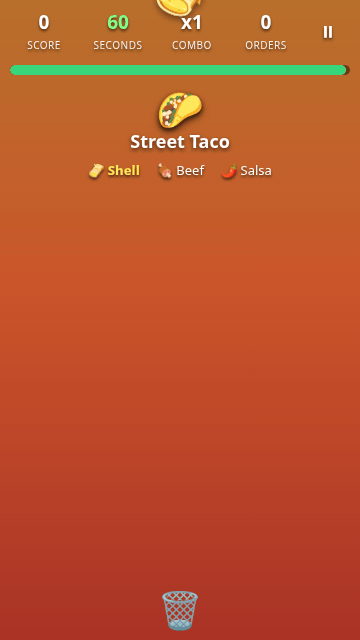

# Kitchen Chaos

The lunch rush is on! Ingredients rain down the kitchen — swipe through them like a knife to cut them, in the order each dish needs them.

## Play it

- **Play in your browser:** [retroromrunner.itch.io/kitchen-chaos](https://retroromrunner.itch.io/kitchen-chaos)
- **Also playable here:** [yearly-quarry-hh7v.here.now](https://yearly-quarry-hh7v.here.now/)
- **Or open `index.html` in any browser** — no build step, no downloads (keep `music-v4.mp3` beside it for the background music).

## How to play

Swipe across falling ingredients to cut them. Cut them in the order shown at the top of the screen to complete each dish.

- Complete an order to score points and earn +2 seconds.
- Cut the wrong ingredient and the whole dish goes in the bin — minus points, minus time, combo gone.
- The rush gets faster and faster as the clock runs down.
- How many orders can you serve in 60 seconds?

Six dishes, three ingredients each — burgers, pizza, salad, tacos, pasta, and a breakfast sarnie. A correct cut bursts into a splash of colour and fireworks. A wrong cut just makes a sad little grey cloud.

## About

Kitchen Chaos was made for the AI Games Jam (Chrono Games), where it was voted on for original idea and gameplay. The code and the Web Audio sounds were made with AI assistance.

Designer
